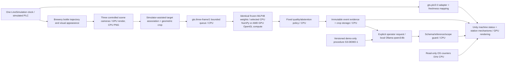

# Stage 3 architecture and contract

No real PLC writes, AI commands, physical rejection, diagnosis or automatic recovery. PLC conventional actions remain separate; new visual presenter examples do not rewrite telemetry. Old RF/classical/Gemma backends/results remain separate. MLP-versus-RF is not a pure CPU/GPU comparison.

Frame contract fields: contract,line_id,session_id,bottle_id,batch_id,capture_utc,source_time,product,target_count,observations_available,frames. Exactly three frames with station_id,neutral frame_id,PNG image,geometric ROI. Additional fields (including hidden class/fault/mask) rejected. Original256×256 frames and160×160 crops retained. Identities route/storage only; model input exclusively24×24RGBfloat32. Renderer temporarily assigns target mesh to dedicated capture layer10, restored before next frame. No layer/object masks sent to inference. Three views are one inspection bay/shared acquisition trigger, not three independently tracked physical cameras.

CPU: NumPy dense matrix/ReLU/softmax; GPU: same two float32 dense matrices via project GLSLcompute shader/EGL. GPUselected only if AMD hardware GL renderer verified; query timing and actual result device recorded. Preprocessing, image quality/threshold policy remain CPU in both paths. Scores uncalibrated. No NPU, CUDA, ROCm neural runtime, Qualcomm or cloud inference claimed. Ollama’s existing language backend is independent of vision selection.

Session is the simulated PLC session. Reset starts a new session; results retain old IDs and timestamps. CPU/GPU switch is recorded on selected device and applies to the next entire batch; running batch keeps its backend. Queue2batches/one worker; on overflow explicit dropped work.2s age/deadline; display current only≤3s and unpaused/matching session/online. Historical event review retains result, never turns it into a current pass.200recent in-memory records plus60retained defect/uncertain review records, preserved across restart;600image files per image directory; structured audit persists locally.

Replaceable InspectionBackend.predict(station,RGBimage)->fixed result dictionary; no file labels or simulator truth. Versioned camera config, line IDs, batch/job storage keys support a future independently scheduled line instance, but only Line01 is implemented. Generic transport/control integrations remain future work.
