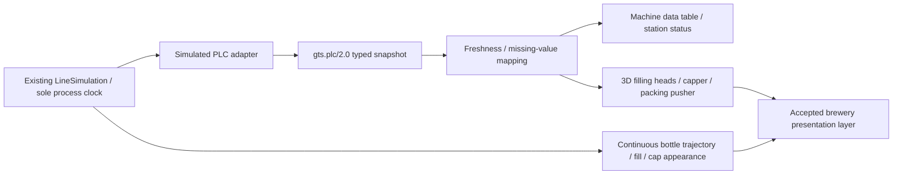

# Simulated PLC telemetry — gts.plc/2.0

No physical equipment, external PLC driver, OPC UA, MQTT or broker. The source is the existing C# LineSimulation, seed42, one authoritative 0.05 s process tick. Normal initial/reset state includes its preserved 40 s pre-roll. All timestamps are simulation seconds, not UTC or network acquisition time. A GUID session changes on reset. Frame sequence increases per published frame; it is separate from the earlier observation sequence.

The simulated adapter publishes each process tick (20 Hz in simulation time). At8× this can be160updates/wall-second; rendering reads the latest frame. During intentional pause it emits a nominal 20 Hz wall-time heartbeat with unchanged source time, explicit simulation_paused=true and continued sequence. This heartbeat does not advance the process. The receiver records monotonic wall receipt time; beyond1.5s without a frame current state is Stale. Missing/invalid values produce Unknown; no invented zero. Stale numeric mechanisms hold their last applied position, while directly simulator-driven bottles may continue. This is deliberately visible in the development test.

Each frame contains schema, session, sequence, source_time, simulation_paused and tags. Each tag contains name, asset, type, unit, source_time, quality, has_value, origin and typed number/boolean/text fields. Only the field selected by type is meaningful. Missing values can retain a previous/raw number but has_value=false makes it unusable. Units are explicit scene units, not calibrated physical metres or conveyor speeds.

| Tags (Line01. prefix) | Type / unit | Source and meaning |
|---|---|---|
| Conveyor.Running | bool / boolean | Any non-rejected bottle advanced in the latest process tick. Not a motor sensor. |
| Conveyor.Speed | float / scene units/s | Calculated mean X velocity of bottles that moved in that tick;0when none moved. Not whole-line throughput. |
| BottleCount | int / bottles on line | Active non-rejected bottles, not lifetime production. |
| Infeed.ProducedTotal | int / bottles | Simulator admitted total. |
| Outfeed.BufferCount | int / bottles | Non-rejected bottles at X≥5. Finite spacing/population, maximum72total bottles. No invented rated buffer capacity. |
| Outfeed.PackedTotal | int / bottles | Existing packed counter. |
| Outfeed.Blocked | bool / boolean | Presenter-commanded simulated outfeed restriction; pack interval3.4s instead of0.5s. Not a sensed physical obstruction or total stop. |
| Outfeed.AccumulationHigh | bool / boolean | Calculated conventional threshold buffer≥15; distinct from alarm history. |
| Infeed/Filler/Capper/Inspection/Packer.State | string / state | Calculated from actual location, dwell, X movement and queuing. Running if current activity, Blocked if present bottles cannot advance; Waiting if no active operation. Packer explicitly Blocked under commanded restriction. Normal local queues can also be Blocked: not an inferred fault. Paused process retains snapshot state with separate pause flag. |
| Filler.Head1…4.PositionY | float / scene units | Calculated nozzle stroke from simulator head association and dwell. |
| Capper.Angle | float / degrees | Simulator cumulative turret angle. |
| Packer.PusherZ | float / scene units | Calculated pusher stroke from simulated last-packed time. |

19tags. tag source_time equals the snapshot source time. All state/position/velocity/count computations are application calculations, not AI or independently measured PLC instrumentation. Raw JSON is optional and does not include injected cap/fill fault labels or private host telemetry.

## Presentation mapping

FactoryGeometry consumes mapped numeric mechanisms in Stage2; BreweryPresentation copies their transforms. Old non-Stage2 code paths retain legacy simulator mechanism calculation. Five new status signs exist only on presentation layer9; frozen inspection camera sees layer8. Station/table selection share FactoryApp.Selected; tag clicks select the owning machine, machine clicks select that machine's tags. Status text remains explicit without relying on colour. Stage1 materials/products/cameras unchanged.

Bounded development flags: --telemetry-dev true exposes F9 publication suspension/resumption and F10 missing/restore filler tags. Simulator remains live, test state labelled. No default outage/control, no hardware telemetry or command execution. --telemetry-audit true saves local snapshots for native QA. These flags are absent from the normal launcher.

A real PLC adapter is future work: transport, device timestamps, reconnect semantics, complete machine-state definitions, measured units and physical tracking would need independent engineering and validation. This demonstrator does not claim those integrations.
