# Stage4 architecture

```mermaid
flowchart LR
 S[One fixed-step scheduler] --> L[Independent line instances]
 L --> P[Per-line simulated PLC contract]
 P --> V[Machine animation and status mapping]
 L --> G[Continuous bottle geometry]
 G --> C[Simulator-assisted trigger queue]
 C --> I[Three controlled station camera Render / ReadPixels]
 I --> H[PNG transport and active-session registry]
 H --> Q[Bounded fair one-pending-batch-per-line queue]
 Q --> N[Same frozen MLP weights: CPU NumPy or AMD GL compute]
 N --> D[Unchanged quality / threshold policy]
 D --> E[Per-line bottle evidence and bounded audit]
 E --> U[Selected-line operator cards / review]
 E -. explicit request only .-> O[Optional local Qwen; preserved six-call ledger]
 M[1Hz unprivileged counters] --> U
 W[Independent benchmark supervisor] --> X[Stop owned phase and recover one-line CPU]
```

Telemetry schema gts.plc/2.0 adds line_id and line-prefixed tag names; original defaultLine01 behaviour remains compatible. Each line has a distinct adapter session, independent seed42+index, counters/buffers/fault state. One scheduler advances every active line by0.05s per tick, including offscreen lines. New lines have their own40s synthetic pre-roll, not copied telemetry. Clock is paused globally; reset selected line replaces its session. Existing stationary machinery consumes mapped telemetry; continuous bottle geometry remains simulator-derived and is labelled synthetic, not a real PLC-driven coordinate stream.

Images keep gts.three-frame/1: line/session/bottle/batch/station/frameIDs, captureUTC, source simulator time, product, association quality and256×256PNG with160×160ROI. No expected class, fault label, mask or simulator scoring truth. Controlled camera scale, light, geometry, material and frozen24×24preprocessing from Stage3. Per-line camera transforms offset with the instance. One shared inspection light prevents multiplying illumination; only current target receives layer10, camera far clip4units and grid12units minimum separation. Cameras render explicitly at triggers, not continuously. Three scratch targets/readers are reused; each line owns three camera transforms.

Normal station crossings are observed for every line, retained in a bounded acquisition queue, and served round robin≤one3viewcapture/frame. A delayed synthetic bottle is temporarily reposed at the station during capture and restored before normal rendering; this is simulator-assisted image authoring, not proof of a real delayed-frame camera. Acquisition associations expire after2s with explicit drop counters. Normal target sampling≤0.667batches/line/s. Benchmark cadence reposes a live eligible bottle at a declared rate irrespective of natural crossing; process speed stays1. No offscreen inspection suppression.

Backend FIFO admission with one pending/running batch per line≤48queued batches avoids a line monopolising the queue. Device switches take effect between complete batches; selected/actual devices reported separately. Registry changes retire queued work; active registry rechecked after inference. Old records remain audit, never current evidence in a new session. Duplicate cache8192batchIDs and24576reservedframeIDs; recorddeque4096, reviews192, UItextures48, framehistory300, maximum saved frame rows160000. Image history3072frame/crop pairs; each audit stream rotates3×4MiB. Expired referenced crops return an honest404.

Qwen does not change vision findings. Explicit requests use the existing Stage3ledger/remaining budget, durable reservation and source-scope guards. No language inference in Stage4verification/capacity. Service loopback only; no industrial control or external publishing endpoints. Stage4units/port separate from earlier stages; prior compiled baseline remains usable.

Composite bottle/station identity includes line and session; all result lookups retain this scope. Registry recovery after backend restart restores current sessions without replaying retired evidence. Backend offline clears current findings and resource readings to unavailable/N/A while the scheduler/rendering continue. Evidence files survive, but prior review history is not reconstructed into a new backend process. Generated mesh assets are released on line removal/reset; scratch textures/readers shared across line instances.

Measured candidate9ea is preserved in source history; later safety/metric closure did not change measured scene/model/acquisition conditions. Separate workload reports never derive exact GPU shares from subtracting runs. No Qwen workload included in capacity; its button remains explicit and preserves the existing ledger.
